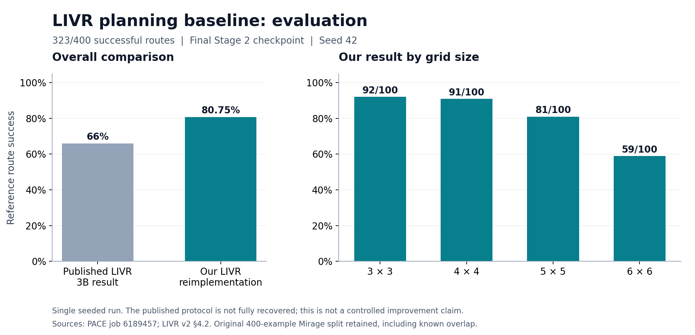

# SPARA

Spatial Planning with Adaptive Representation Adjustment. The first phase
reimplements LIVR's Qwen2.5-VL-3B planning baseline. See the accepted
[implementation specification](docs/LIVR_IMPLEMENTATION_SPEC.md) and
[project plan](docs/SPARA_PROJECT_PLAN.md).

The [PACE pilot report](docs/LIVR_PILOT_REPORT.md) records 21 passing tests,
successful actual-model checks and measured resources. The completed baseline
scored **323/400 (80.75%)** after 10+10 epochs, using 1 hour 34 minutes of H200
time. Saved responses were verified by local reference rescoring; the final
Stage 2 backup is still transferring. See [the full-run results](docs/LIVR_BASELINE_RESULTS.md)
for the comparison, assumptions and evidence.



Training curves, reproducible chart commands and the per-example evidence are
in the [results report](docs/LIVR_BASELINE_RESULTS.md).

## Baseline commands

Python 3.11 is the tested environment. Install an appropriate PyTorch 2.6.0 /
torchvision 0.21.0 build, then `python -m pip install -e '.[model,test]'`.
On Windows, run these commands with `.venv/Scripts/python`; on Linux use
`.venv/bin/python`. The actual model runs belong on an allocated PACE GPU.

```bash
python -m spara.cli prepare-data --data-root data/vsp
python -m spara.cli fetch-model --output .cache/processor --processor-only
python -m pytest -q
```

Tests use a tiny random Qwen model for architectural checks and the real released
records/tokenizer for data and serialization checks. They do not download 3B
weights or establish a reproduced benchmark result. Integration tests skip if
the dataset/processor is absent; prepare both for a complete test run.

`prepare-data` verifies both archive hashes, preserves the original 1,000/400
records, and downloads the hash-pinned reference simulator. Scoring calls those
upstream functions and `mathruler==0.1.0`; there is no separate SPARA scorer.
The original split has seven shared layouts affecting eight test rows. Helper
images remain in the source archive but never enter model inputs.

## PACE pilot

From this workstation:

```bash
python scripts/pace/sync.py --target pace-ice
ssh pace-ice
```

On the cluster, run `bash -l ~/scratch/SPARA/code/scripts/pace/setup.sh` once.
It prepares the environment, data and model under scratch. `SPARA_REMOTE_ROOT`
changes that root; `--target` / `SPARA_SSH_TARGET` changes the personal SSH alias.
Do not run training on the login node.

Select compatible hardware and your account settings after inspecting Slurm:

```bash
export SPARA_ACCOUNT=<your-account> SPARA_QOS=<your-qos>
export SPARA_PARTITION=ice-gpu SPARA_GPU=gpu:h200:1
export SPARA_PILOT_MINUTES=40
bash ~/scratch/SPARA/code/scripts/pace/submit-pilot.sh
```

The H200 request is an example, not a team requirement. The pinned CUDA 12.4
stack targets Ampere/Hopper/Ada; Blackwell requires a separately verified stack.
Check actual VRAM and availability. The approved pilot ceiling is **one GPU-hour
total across attempts**, including tests and checkpoint I/O in the allocation.
Before retrying, use `sacct -j JOBID --format=JobID,State,ElapsedRaw,AllocTRES`
and subtract actual allocated time; do not submit overlapping pilots.

Pilot logs are `logs/pilot-JOBID.log`; artifacts are `results/pilot-JOBID/`.
The pilot verifies gradients, learning on one training example, checkpoint
round-trip, optimizer restoration/reset, and cached/uncached logits; it profiles
typical/longest examples in both stages. Its diagnostic checkpoint and greedy
outputs are **not** a completed baseline or benchmark evaluation.

## Full training and reference evaluation

The first full run is approved for one H200, four CPUs, 96 GiB RAM and at most
four allocated GPU-hours. For another run, settle its resource budget first. Run the
following inside the GPU job (paths are illustrative):

```bash
python -m spara.cli train --stage 1 --data-root /path/to/data/vsp \
  --base-model /path/to/models/Qwen2.5-VL-3B-Instruct --output /path/to/stage1
python -m spara.cli train --stage 2 --data-root /path/to/data/vsp \
  --checkpoint /path/to/stage1/final --output /path/to/stage2
python -m spara.cli evaluate --data-root /path/to/data/vsp \
  --checkpoint /path/to/stage2/final --output /path/to/evaluation
```

The recipe is [configs/livr.json](configs/livr.json): full language fine-tuning,
frozen vision/projector, four random learned tokens, 10 epochs per stage,
microbatch 1 / accumulation 8, AdamW 1e-5 and separate warmup/cosine schedules.
Stage 2 loads weights with a fresh optimizer. Within a stage, `--resume` restores
the saved optimizer, schedule, iteration position and random state. Only load
trusted training-state checkpoints. Optional `checkpoint_every_steps` writes
additional resumable checkpoints; it defaults to zero because full checkpoints
are large. Provision storage before enabling periodic saves.

Evaluation samples 400 records in original order with seed 42, temperature 0.7,
top-p 0.9 and max 1,024 new tokens, preserving inherited generation defaults.
It writes raw responses, extracted routes and reference outcomes, plus overall
and per-grid results. No test-based checkpoint selection is implemented.

## Reproduction assumptions

The public sources do not recover LIVR's exact model/package revisions. This
implementation pins an available Qwen revision and stock Transformers 4.51.3.
The four latents occur after the user-end marker and before the assistant header.
The header has no trailing newline, following Mirage evaluation; the released
answer and assistant-end token are supervised. Tokenization keeps the inference
prefix intact at the answer boundary. All old language embeddings/output-head
weights remain trainable. New rows use the model's normal initialization scale.

SDPA supports the explicit Stage 1 mask. Multimodal positions are computed from
the original sequence before applying that mask. FP32 parameters/AdamW states
with BF16 autocast, gradient checkpointing, max gradient norm 1.0 and standard
AdamW bias/norm decay exclusions are recorded engineering choices. Tiny-model
cache tests use tighter tolerances than actual-model tests. Actual-model cache
validation checks FP32 logits at `atol=1e-3, rtol=1e-4`. BF16 logit errors, KL
divergence and argmax agreement are reported as numerical diagnostics; Stage 2
must match stock Qwen's FP32 and BF16 cached and uncached paths exactly. The initial BF16
elementwise/distribution thresholds proved inappropriate for stock Qwen's kernel
roundoff. Retained diagnostics are reproducible with `scripts/pace/check_cache.py`.

Run manifests record source/data hashes, model revision, package versions,
trainable parameters, token IDs, preprocessing, hardware, decoding and lineage.
Keep checkpoints and results on scratch for execution, then export completed
artifacts to a durable destination before relying on scratch retention.

From the workstation, monitor an already submitted job and collect both final
checkpoints, logs and evaluation evidence with:

```bash
python scripts/pace/collect_run.py --job JOBID --output results/pace-baseline-JOBID
```

The collector reads cluster files, verifies local copies with SHA-256 and never
submits a GPU job. Keep it running until collection finishes. It accepts the
same `--target` and `--root` overrides as source deployment; restarting skips
files whose size and hash already match. `latest-status.json` reports progress
and `backup-verification.json` records verified files under the output directory.
After a successful job, it independently rescores the saved responses against
`--data-root` (default `data/vsp` in this project), checks complete training and
budget accounting, and writes `run-validation.json` and `RUN_REPORT.md`.
The local collector requires this workstation to remain running.

## Scaffolding Minds baseline (helper-supervised reference)

`src/spara/scaffolding/` adapts [Scaffolding Minds v2](docs/related_literature/Scaffolding_Minds_2608.19669v2.pdf)
to the LIVR baseline's data, backbone, evaluator and decoding settings. Unlike
LIVR, it trains with helper images: a value-function heatmap per map
([ADR-0003](docs/adr/0003-scaffolding-minds-helper-supervised-reference.md)).
Report it separately from LIVR and SPARA. The recipe is
[configs/scaffolding.json](configs/scaffolding.json). Method mapping, recorded
assumptions and checks are in [the specification](docs/SCAFFOLDING_BASELINE_SPEC.md).
The first PACE run (job 6257067, logs in `spara_results/`) scored 0/400 because
the paper-literal latent loss collapsed the language model. The default recipe is
now variant B (a zero-initialized linear latent projection plus MSE), and
`configs/scaffolding-mse.json` is variant A (MSE only); neither has run on PACE
yet. See [the specification](docs/SCAFFOLDING_BASELINE_SPEC.md#first-run-job-6257067).

On a GPU machine, one script runs the whole baseline. It trains all three
phases and evaluates both the Stage 1 and the Stage 2 checkpoints, writing logs
to `RUN/logs/`:

```bash
bash scripts/run_scaffolding.sh --model M --run R          # full baseline
bash scripts/run_scaffolding.sh --model M --run P --pilot  # bounded pilot
```

Rerun with the same `--run` to continue: completed phases are skipped. A phase
that stopped part-way is left untouched unless you pass `--retry-incomplete`.
`--phases` selects a subset, `--scaffold-from DIR` reuses another run's completed
Scaffolding Phase, and `--help` lists the remaining options. RL starts only if
Stage 1 scored at least `--rl-floor` (default 5%), and it stops itself after five
consecutive steps in which every rollout fails, recording why in `stage2-rl/stopped.json`. The script
wraps these CLI calls:

```bash
python -m spara.scaffolding.cli train --phase scaffold --base-model M --output S1A
python -m spara.scaffolding.cli train --phase predict --base-model M --encoder S1A/final --output S1B
python -m spara.scaffolding.cli evaluate --checkpoint S1B/final --output EVAL1
python -m spara.scaffolding.cli train --phase rl --checkpoint S1B/final --output S2
python -m spara.scaffolding.cli evaluate --checkpoint S2/final --output EVAL2
```

On PACE, submit `bash scripts/pace/submit-scaffolding.sh pilot` (or `baseline`)
with the same account and GPU variables as the LIVR pilot, plus `SPARA_MINUTES`.
Only do this after the budget is agreed. The baseline job runs the script above
and passes through `SPARA_RUN` (continue an earlier run), `SPARA_CONFIG`,
`SPARA_PHASES`, `SPARA_SCAFFOLD_FROM` and `SPARA_RL_FLOOR` from the submitting shell.

To do all of that in one step from a PACE login node — prepare the `$ROOT/code`
layout, run `setup.sh`, run the CPU tests, then submit a single job that runs the
pilot and the full baseline back to back — use:

```bash
bash scripts/pace/run-all-scaffolding.sh                 # pilot, then baseline
bash scripts/pace/run-all-scaffolding.sh --no-baseline   # stop after the pilot
bash scripts/pace/run-all-scaffolding.sh --continue DIR  # continue an earlier run
bash scripts/pace/run-all-scaffolding.sh --dry-run       # print the plan only
```

Both phases share one allocation (`scripts/pace/scaffolding-all.sbatch`), so the
baseline cannot lose the node to a second queue wait. Settings live in
[`scripts/pace/pace.conf`](scripts/pace/pace.conf): edit the GPU and walltime there
and they persist. Anything set in the environment overrides the file, and
`--config` points at a different one. The partition is always `ice-gpu`. Walltime is
`PILOT_HOURS + BASELINE_HOURS` whole hours, 16 by default, unless `HOURS`
overrides it. Account and QoS are left to your default Slurm
association, and `ROOT` defaults to `$HOME/scratch/spara` with `code/` linked to this checkout. A failing pilot stops the job before the baseline, but nobody sees the
pilot's numbers first, so the full-run budget review that
[the specification](docs/SCAFFOLDING_BASELINE_SPEC.md) asks for means running
`--no-baseline`, then rerunning with `--continue` once the numbers check out.
