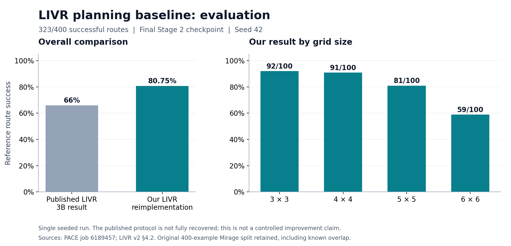
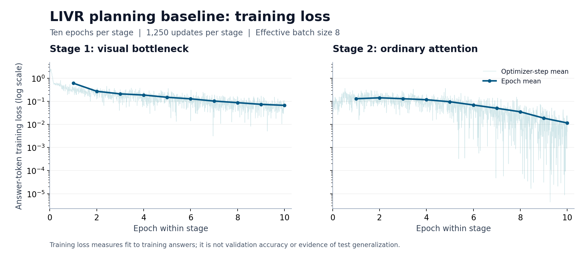

# LIVR full baseline results

Updated 2026-10-11. **Training and evaluation completed; final checkpoint backup is still in progress.**

The final Stage 2 model succeeded on **323/400 examples (80.75%)** using the
pinned Mirage reference evaluator. This is **14.75 percentage points above**
LIVR's reported 3B VSP result of 66%. The difference is an observed comparison,
not proof that this reimplementation is equivalent to or improves on the authors'
implementation. Exact original model/package revisions, test manifest and some
implementation settings remain unavailable; see the [specification](LIVR_IMPLEMENTATION_SPEC.md).
A subsequent [discrepancy audit](LIVR_REPRODUCTION_AUDIT.md) found no scoring
or answer-leakage error in the checked paths. Excluding the eight known overlapping
test rows gave 315/392 (80.36%); the cause of the paper-score gap remains unknown.

| Grid | Correct | Test examples | Success rate |
| --- | ---: | ---: | ---: |
| 3 x 3 | 92 | 100 | 92% |
| 4 x 4 | 91 | 100 | 91% |
| 5 x 5 | 81 | 100 | 81% |
| 6 x 6 | 59 | 100 | 59% |
| Overall | 323 | 400 | 80.75% |

## Charts and portable evidence





The [committed evidence bundle](experiments/livr-6189457/README.md) contains all
400 generated answers/outcomes, aggregate counts, both training logs, provenance
and the discrepancy audit. The charts are available as PNG and SVG under
`docs/figures/`. Regenerate them from the repository root without model weights:

```bash
python -m pip install -e '.[report]'
python scripts/plot_livr_results.py
```

The loss curves show training fit, not validation accuracy. There is one seeded
run, so the figures do not claim across-seed uncertainty or a controlled
improvement over the paper.

## Completed run

PACE job `6189457` finished with Slurm state `COMPLETED` and exit code `0:0`.
It used one H200, four CPUs and 96 GiB requested host RAM for **5,664 allocated
GPU-seconds (1 hour 34 minutes 24 seconds)**, within the separately approved
four-hour limit. No retry or additional full-run allocation was submitted.
The earlier [pilot](LIVR_PILOT_REPORT.md) consumed 818 GPU-seconds; pilot plus
full run total 6,482 seconds (1 hour 48 minutes 2 seconds).

Both stages completed ten epochs and 1,250 optimizer updates over the original
1,000 training records. The [recipe](../configs/livr.json) and training code
were unchanged during this run. Evaluation used the final Stage 2 checkpoint,
seed 42, one sampled answer per test record, and all 400 records in original
order. No test-based checkpoint selection or hyperparameter tuning occurred.
The released split's overlap affecting eight test records was preserved and is
disclosed in the [dataset audit](research/LIVR_DATASET_COMPARABILITY.md).

## Evidence checks

Copied and SHA-256 verified 14 small run-evidence files from PACE. Local checks
confirmed complete final-checkpoint markers, both sets of 1,250 sequential
updates, finite losses and gradients, final zero learning rates, and matching
recipe/source hashes across training and evaluation manifests. All 400 saved
responses were rescored locally using the pinned reference evaluator; every
record and the overall/per-grid summaries matched. Slurm accounting confirmed
successful completion within the resource ceiling.

Evidence is under `results/pace-baseline-6189457/` (ignored by Git):

- `evaluation-audit.json`: completed training, provenance, scoring and accounting checks.
- `results/baseline-6189457/evaluation/`: all raw responses, the summary and manifest.
- `evidence-verification.json`: hashes for the retrieved small evidence files.
- `final-accounting.txt`: final Slurm accounting.
- `source-snapshot.zip` and `source-snapshot-sha256.json`: source matching all 24 runtime manifest hashes, including remote package metadata.
- `backup-verification.json`: file-by-file verification of checkpoint exports.
- `collector.log` and `collector-errors.log`: ongoing transfer status.

## Backup status

The entire Stage 1 resumable checkpoint has been copied and verified locally.
Stage 2 export is still running; the checked verification record covered about
41.63 GiB across both stages at this update. Do not treat the full Stage 2 backup
as complete yet. Remote final checkpoints remain under
`~/scratch/SPARA/results/baseline-6189457/stage1/final/` and `stage2/final/`.
The finalized GPU budget is `~/scratch/SPARA/logs/baseline-budget.json`.

The hidden local collector runs independently of this chat and requires this
workstation to remain running. Its `latest-status.json` can be stale during large
file transfers; use final accounting and this evidence audit for run completion.
After all exports and its final checks finish, the collector writes
`run-validation.json` and `RUN_REPORT.md`. Restart it if needed with:

```powershell
.venv/Scripts/python scripts/pace/collect_run.py --job 6189457 --output results/pace-baseline-6189457
```

Matching files are reused after size/hash verification. No source code or run
artifacts have been committed or pushed by this results update.
