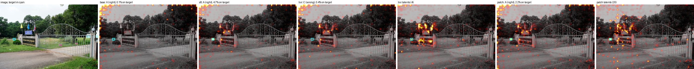
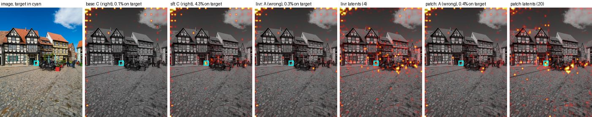
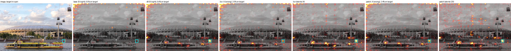
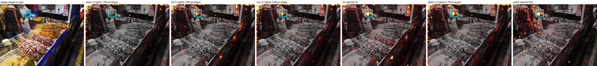

# V* attention: where the answer looks (2026-11-19)

**Result:** in both latent models, the position that produces the answer puts more attention on the
latent tokens than on the whole image, and about half as much on the image as direct SFT does. The image
attention that remains finds the target less often. This is consistent with the lower V* scores of the
latent arms; it does not show that the attention pattern causes them.

Models, training and scores are in [PERCEPTION_VSTAR_RESULTS.md](PERCEPTION_VSTAR_RESULTS.md). The four
models here are the ones with saved weights: the untuned base model, `sft`, `livr` (original run, with
the bottleneck stage) and `patch` (globals hidden from the answer).

## What was measured

- **Questions:** all 191 V* questions at native image size (mean 4,472 image tokens), in the project's
  prompt format, one forward pass each.
- **From:** the last prompt position, which produces the answer's letter. Where a reply opens with a
  separate punctuation token, that token is appended first (1 question, base model).
- **To:** every prompt token. Attention is averaged over the 16 heads and kept per layer (36 layers).
- **Target:** V* releases a box around each question's target object. "On target" is the share of
  image attention that lands on grid cells the box touches. The box covers 0.32% of the image on
  average, which is the share expected if attention ignored the target.
- **Layer bands:** early is layers 1 to 12, middle 13 to 24, late 25 to 36.

## Image against latents

Share of the answer position's attention, mean over questions, heads and all layers.

| Model | V* correct | On the image (4,472 tokens) | On the latents | Per image token | Per latent token |
| --- | --- | --- | --- | --- | --- |
| Base | 133 | 8.8% | none | 0.0020% | |
| `sft` | 131 | 11.1% | none | 0.0025% | |
| `livr` | 121 | 4.6% | 10.3% (4 tokens) | 0.0010% | 2.6% |
| `patch` | 119 | 6.0% | 8.7% (16 patch tokens) | 0.0013% | 0.54% |

- A LIVR latent receives about 2,500 times the attention of an image token; a patch latent about 400 times.
- The rest of the attention (85 to 91%, depending on the model) goes to text tokens.
- LIVR's four latents are not used equally: 4.1%, 1.0%, 3.9% and 1.4%.
- The patch model's four hidden global latents receive exactly zero, as the mask intends.

### By layer band

| Model | Image: early | Image: middle | Image: late | Latents: early | Latents: middle | Latents: late |
| --- | --- | --- | --- | --- | --- | --- |
| Base | 8.8% | 10.6% | 7.0% | | | |
| `sft` | 9.9% | 8.3% | 15.0% | | | |
| `livr` | 5.5% | 4.0% | 4.4% | 7.1% | 6.8% | 17.1% |
| `patch` | 6.4% | 4.6% | 7.1% | 9.6% | 6.0% | 10.5% |

- The gap is widest late. SFT's image attention rises to 20 to 39% in layers 32 to 36; LIVR's stays at
  5 to 8% there, while its latents take 42% and 38% in the last two layers.
- The latent models look at the image less in every band, not only late.

## Attention on the target

Share of image attention on the target box (chance is 0.32%).

| Model | Early | Middle | Late | Late, right answers | Late, wrong answers | Questions with late share above 5 times chance |
| --- | --- | --- | --- | --- | --- | --- |
| Base | 0.37% | 0.22% | 0.23% | 0.26% | 0.17% | 1 of 191 |
| `sft` | 0.41% | 0.94% | 5.7% | 6.4% | 4.3% | 154 |
| `livr` | 0.43% | 0.66% | 2.0% | 2.5% | 1.2% | 84 |
| `patch` | 0.44% | 0.71% | 4.0% | 4.9% | 2.5% | 124 |

- **Trained models localise the target late.** SFT's peak is layer 28, where 21.6% of image attention
  is on the target. LIVR peaks at the same layer with 5.5%; the patch model at layer 30 with 12.9%.
- **LIVR localises about a third as strongly as SFT**, and the patch model about two thirds.
- **Within each trained model, right answers have more attention on the target than wrong ones.**
- **The base model does not localise at this position at all** (at or below chance in every band), yet
  it scores 133. So this measure does not rank models by accuracy: the base model evidently reads the
  image some other way, for example at earlier text positions. Training on short answers moved the
  look-up to the answer position.
- **The latents do look at the target.** From the latent tokens, the share of image attention on the
  target is 3.0% for LIVR (3.7% right, 1.9% wrong) and 2.0% for the patch model, about 6 to 9 times chance.

## Examples

Each row: the image with the target in cyan, then each model's answer-position map (mean over all layers
and heads, scaled to its own 99.5th percentile), and the latent tokens' map for the latent models.

Question 75, "What is the color of the umbrella?" (target 0.14% of the image; LIVR wrong):

Question 78, "What is the color of the baby carriage?" (LIVR and patch wrong):

Question 99, "Does the flag have two or three colors?" (LIVR and patch wrong):

Question 1, "What is the material of the glove?" (all four right):

These four were picked, not sampled: the first three are among the four with the largest SFT-over-LIVR
gap in late target attention, out of the 23 questions SFT got right and LIVR got wrong.

All 191 rows are in `results/vstar-attention-report/index.html` (34 MB with pictures; `results/` is not
tracked by git, and the same folder is on PACE-ICE scratch).

## What this does and does not show

- **Shown:** after training with latents, the answer position attends less to the image and more to
  the latents, and reaches the target less, than after SFT on the same rows.
- **Not shown: cause.** Attention weights are not a measure of what the answer depends on. The earlier
  ablation is the stronger evidence here: removing the latent tokens from the prompt left LIVR's V*
  score unchanged (121), so the loss is not simply the answer reading the latents.
- **Not measured:** attention for the latent models with the latents removed, which would show whether
  image attention returns when the latents are gone; and the ablation runs (no bottleneck, 1 + 1 epochs),
  whose weights were not saved.
- **Averaging:** heads are averaged, and the pictures average layers too. A single head that reads the
  target would be diluted.
- **One position:** only the answer position (and the latents) is read. The base-model result shows
  that other positions can matter.
- **Base model replies:** this run's first token matches the scored reply's opening in 170 of 191
  questions for the base model (the scored replies more often open with a full stop or colon); the
  chosen letter differs in 2. For the three trained models all 191 match.
- **One seed per model**, as in the results document.

## Where the data is

On PACE-ICE under `$HOME/scratch/SPARA/results/`:

- `vstar-attention-{base-7183433,sft-7182221,livr-7182222,patch-7182223}/`: `rows.jsonl` (per question,
  per layer: image share, target share, attention on each latent) and `maps/` (attention to every image
  token, per layer, for the latent rows and the answer row).
- `vstar-attention-report/`: the 191 pictures, `index.html` and `summary.json`.

Code: `src/spara/vstar_attention.py`; `python -m spara.cli vstar --stage attention` and
`--stage attention-report`.
