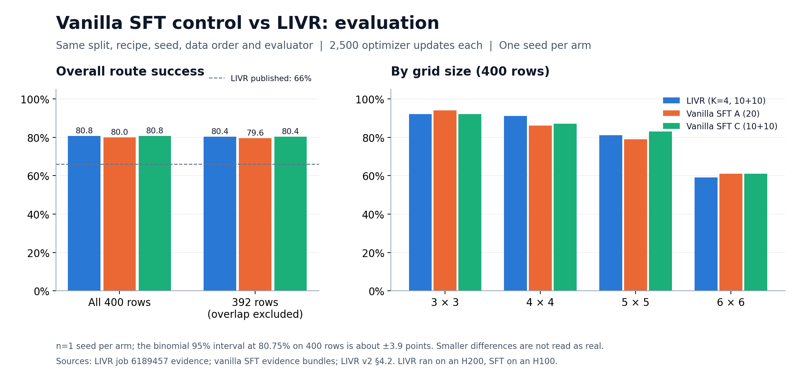
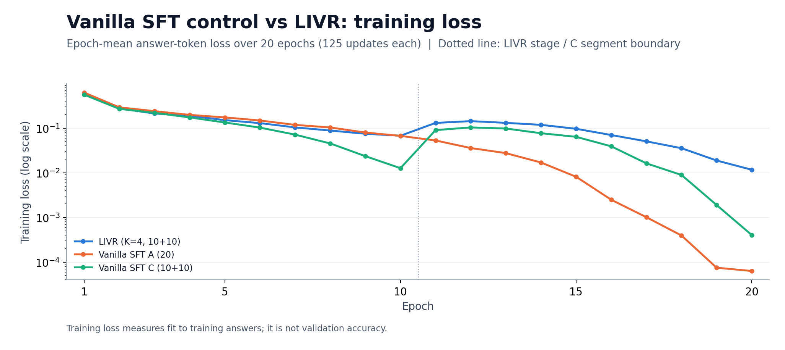

# Direct SFT control results

Updated 2026-10-14. Plan: [VANILLA_SFT_CONTROL_PLAN](plans/VANILLA_SFT_CONTROL_PLAN.md);
decision: [ADR-0004](adr/0004-reinstate-vanilla-sft-control.md).

**On this split, at one seed each, the latent tokens contribute no measurable
accuracy, and the gap to LIVR's published 66% is not attributable to the latent
machinery.** Both Direct SFT arms land within ±2 points of the
[LIVR baseline](LIVR_BASELINE_RESULTS.md) (80.75%). Arm C, which keeps LIVR's
10+10 segment structure, scored exactly LIVR's 323/400.

This is "no difference detected", not "equal". There is one seed per arm, and the
binomial 95% interval on 400 trials at 0.8075 is about ±3.9 points, so ±2 points is
inside noise. A seed-variance study is the next question and is out of scope here.

| Method | Optimizer updates | 400 rows | 392 rows | Source |
| --- | ---: | ---: | ---: | --- |
| LIVR, K=4, 10+10 epochs | 2,500 | 323/400 = 80.75% | 315/392 = 80.36% | job `6189457` |
| Direct SFT (A), no latents, 20 epochs | 2,500 | 320/400 = 80.00% | 312/392 = 79.59% | [`sft-a-6259811`](experiments/sft-a-6259811/README.md) |
| Direct SFT (C), no latents, 10+10 epochs | 2,500 | 323/400 = 80.75% | 315/392 = 80.36% | [`sft-c-6259811`](experiments/sft-c-6259811/README.md) |
| LIVR, published 3B | — | 66% | — | LIVR v2 §4.2 |

| Grid | LIVR | SFT A | SFT C |
| --- | ---: | ---: | ---: |
| 3 x 3 | 92 | 94 | 92 |
| 4 x 4 | 91 | 86 | 87 |
| 5 x 5 | 81 | 79 | 83 |
| 6 x 6 | 59 | 61 | 61 |
| Overall | 323 | 320 | 323 |

Per grid, each cell is out of 100. No grid differs by more than 5 rows, and with
100 rows per grid the per-grid intervals are about ±8–10 points.

Paired by test row, the runs agree on most items rather than matching by chance
totals. LIVR and C both succeed on 303 rows; each succeeds on 20 rows the other
fails. LIVR and A: 303 both, 20 LIVR-only, 17 A-only. Exact two-sided McNemar
p-values are 1.0 (LIVR/C), 0.74 (LIVR/A) and 0.75 (A/C). No answers were invalid
in any run.





Regenerate the charts without model weights:

```bash
python scripts/plot_sft_comparison.py --sft-a docs/experiments/sft-a-6259811 --sft-c docs/experiments/sft-c-6259811
```

The loss curves show training fit, not accuracy. Without the Stage-1 bottleneck,
both SFT arms fit the training answers more tightly than LIVR (final epoch mean
about 6e-5 for A and 4e-4 for C, against 1.2e-2 for LIVR). That tighter fit does
not show up as a test-accuracy difference. C and LIVR both show a loss rise at
epoch 11, where segment 2 / Stage 2 restarts with a fresh optimizer and a new
warmup, so the rise is not specific to the change in LIVR's attention mask.

## What was controlled

Both arms use the [LIVR recipe](../configs/livr.json) unchanged except for latent
tokens (`latent_tokens: 0`) and the arm's epoch layout: [`configs/sft.json`](../configs/sft.json)
(A, one 20-epoch segment, `order_cycle: 10`) and [`configs/sft-staged.json`](../configs/sft-staged.json)
(C, two 10-epoch segments). The same seed, 1,000 training rows, per-epoch data
order (A replays LIVR's ten permutations twice), learning-rate schedule, 400 test
rows in original order, sampled generation settings and pinned reference
evaluator were used. The input sequence is LIVR's minus exactly the four latent
IDs: verified by `tests/test_sft_control.py` and by the pilot on the real processor
and model. Trainable/frozen parameters (3,085,938,688 / 668,684,288) match LIVR's.
C's segment 2 loads segment 1's weights with a fresh optimizer and restarted
warmup, as LIVR's Stage 2 does. No checkpoint was selected on test data and nothing
was tuned.

## Runs and compute

One run each on a PACE-ICE H100 80GB (`6259811`), not the H200 that LIVR used.
Every logged loss and gradient norm was finite and both arms ended at learning rate 0.

| Phase | GPU-seconds |
| --- | ---: |
| Pilot (2 steps, save, 2 evaluations; peak 55.6 GiB allocated) | ~134 |
| A: train 20 epochs | 5,270 |
| A: evaluate 400 rows | 329 |
| C: segment 1 | 2,655 |
| C: segment 2 | 2,720 |
| C: evaluate 400 rows | 320 |
| Total | ~11,430 (3.2 hours) |

Total use was 3.2 GPU-hours against the plan's 10-hour stop. An earlier allocation
(`6259360`) had a faulted GPU (`NV_ERR_RESET_REQUIRED`) and ran no training. No
retries were needed.

## Deviations and corrections

- **Overlap row indices.** The plan lists the eight train/test overlapping test
  rows as 38, 62, 109, 152, 269, 278, 344, 366. Those are one-based. The zero-based
  `row_index` values used in the evidence are 37, 61, 108, 151, 268, 277, 343, 365.
  These are derived from the data by map layout, and they reproduce LIVR's 315/392.
- **Optimizer state not kept.** The runner deletes `final/training_state.pt` after
  each segment, keeping the ~15 GB weights instead of ~40 GB per checkpoint. C's
  segment 2 uses a fresh optimizer, so nothing needed the state. Model weights stay
  on PACE scratch at `sft-run/results/6259811/` and are not committed.
- **Hardware.** H100 rather than H200. The software stack (CUDA 12.4, torch 2.6.0,
  Python 3.11.9) and evaluator hashes match 6189457.

## Evidence

[`sft-a-6259811`](experiments/sft-a-6259811/README.md) and
[`sft-c-6259811`](experiments/sft-c-6259811/README.md) mirror the
[LIVR bundle](experiments/livr-6189457/README.md). They contain all 400 answers and
outcomes, aggregate and overlap-excluded counts, optimizer-step logs, provenance
with evaluator/data/source hashes, and SHA-256 checksums that the plot script
verifies. `scripts/export_sft_evidence.py` rescored every row with the reference
evaluator before export.
